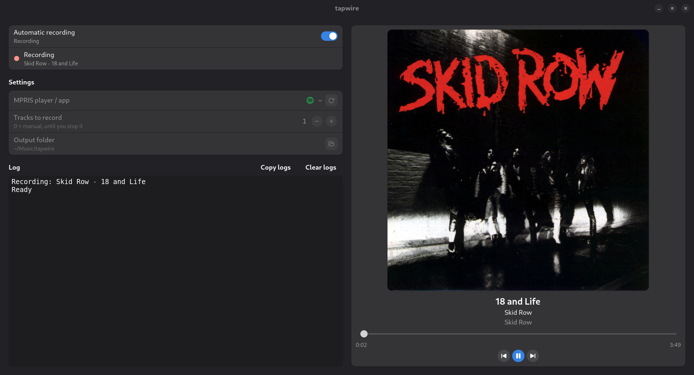

# tapwire

**Press play. Get your playlist as tagged FLAC files, one per track.**

Suppose you are listening to a good playlist in your favorite music app and just want to keep it.
tapwire taps the audio of that app on PipeWire while it plays, and saves every track as its own
FLAC file with title, artist, album and cover art. Tracks are split using the player's own track
information (MPRIS over D-Bus), not by guessing silences, and the sound keeps going to your
speakers the whole time.

## Recording rules

- Only tracks it saw **start** are recorded; the one already playing when you begin is skipped.
  Restarting a track from the beginning (zero it and press play) counts as a start.
- **Pausing, seeking inside a track, or changing track midway discards** the recording.
- A track is saved only if it finished by itself (recorded time ≥ length − 3 s).
- The recording is taken from the app's own stream: your **system volume does not affect it**, but the
  **app's volume (and mute) does**. Keep the app at 100% for a full-level recording.
- **Turn off crossfade** in the player (usually under the player's playback settings). With it on, the next
  track starts before the current one ends, so the track change arrives early and the recording is
  discarded (and its tail would be mixed with the next track anyway). Gapless playback is fine.

## Requirements

PipeWire (`pw-record`, `pw-dump`, `pw-link`), `ffmpeg`, Python ≥ 3.11 and PyGObject
(for the GUI: GTK4 + libadwaita).

```bash
sudo apt install python3-gi gir1.2-gtk-4.0 gir1.2-adw-1 ffmpeg pipewire-bin
python3 -m venv --system-site-packages .venv && . .venv/bin/activate
pip install -e .
```

The external programs are looked up only in `$PATH` directories owned by root and not writable by
others, never in the current directory. To use another copy, set `TAPWIRE_FFMPEG=/absolute/path`
(likewise `TAPWIRE_PW_RECORD`, `TAPWIRE_PW_LINK`, `TAPWIRE_PW_DUMP`).

## Usage

```bash
tapwire players                 # open MPRIS players (name, identity, state, track)
tapwire streams                 # audio streams playing on PipeWire
tapwire run                     # record the only open player until Ctrl+C (default folder: ~/Music/tapwire)
tapwire run -p NAME -n 5        # pick a player from `tapwire players`; stop after 5 saved tracks
tapwire gui                     # graphical interface (same as the tapwire-gui command)
```

Without installing anything, from the project folder (the same commands work: `run`, `players`, `streams`, `gui`):

```bash
python3 src/tapwire gui
```

## The Graphical Interface



## Languages

The interface and CLI text follow the system language (`LANGUAGE`/`LC_ALL`/`LANG`, which GNOME sets
from the user's choice). Source strings are English; a `pt_BR` translation is included. Without a
catalog for the language, English is used. To add a language:

```bash
msginit -i po/tapwire.pot -l fr -o po/fr.po   # translate the msgstr entries
tools/i18n.sh compile                         # builds the .mo files
tools/i18n.sh extract                         # after changing strings in the code
```

## Tests

```bash
PYTHONPATH=src python3 -m unittest discover -s tests -t .
```

## License

tapwire is released under the [MIT License](LICENSE).
